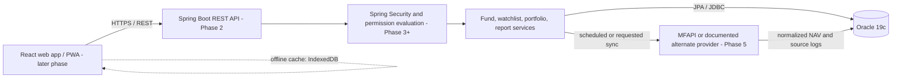

# Architecture and data model

## Phase 1 architecture

Phase 1 establishes the database boundary. Phase 2 now provides the Spring
Boot REST API for database health and read-only fund-house, scheme, and NAV
history access. The React PWA remains planned for a later phase.

For local development in later phases, the browser serves the React page, the
Spring Boot process serves the REST API, and Oracle is the database. All three
must be available for a live application session. The database phase alone
does not provide a page or API.

## Entity relationship diagram

```mermaid
erDiagram
    APP_USERS ||--o{ USER_ROLES : has
    APP_ROLES ||--o{ USER_ROLES : assigned
    APP_ROLES ||--o{ ROLE_PERMISSIONS : grants
    APP_PERMISSIONS ||--o{ ROLE_PERMISSIONS : included
    APP_USERS ||--o{ USER_PERMISSIONS : overrides
    APP_PERMISSIONS ||--o{ USER_PERMISSIONS : overridden

    MUTUAL_FUND_HOUSES ||--o{ MUTUAL_FUND_SCHEMES : owns
    MUTUAL_FUND_SCHEMES ||--o{ NAV_SCHEME_MAPPINGS : maps
    MUTUAL_FUND_SCHEMES ||--o{ MUTUAL_FUND_NAV_HISTORY : has

    APP_USERS ||--o{ USER_FUND_WATCHLIST : tracks
    MUTUAL_FUND_SCHEMES ||--o{ USER_FUND_WATCHLIST : selected
    APP_USERS ||--o{ USER_SIP_DETAILS : schedules
    MUTUAL_FUND_SCHEMES ||--o{ USER_SIP_DETAILS : invested_in
    USER_SIP_DETAILS o|--o{ USER_INVESTMENTS : records
    APP_USERS ||--o{ USER_INVESTMENTS : owns
    MUTUAL_FUND_SCHEMES ||--o{ USER_INVESTMENTS : transaction_for
    APP_USERS ||--o{ USER_NAV_ALERTS : configures
    MUTUAL_FUND_SCHEMES ||--o{ USER_NAV_ALERTS : monitors
    APP_USERS ||--o| USER_PREFERENCES : configures

    APP_USERS o|--o{ USER_LOGIN_AUDIT : generates
    APP_USERS o|--o{ USER_ACTIVITY_AUDIT : generates
    APP_USERS o|--o{ NAV_REFRESH_LOG : requests
    MUTUAL_FUND_SCHEMES o|--o{ NAV_REFRESH_LOG : refreshes
    APP_USERS ||--o{ USER_REPORT_HISTORY : generates

    APP_USERS {
        number user_id PK
        string username UK
        string email UK
        string password_hash
        number is_enabled
    }
    APP_ROLES {
        number role_id PK
        string role_name UK
    }
    APP_PERMISSIONS {
        number permission_id PK
        string permission_code UK
    }
    MUTUAL_FUND_HOUSES {
        number house_id PK
        string house_code UK
        string house_name
    }
    MUTUAL_FUND_SCHEMES {
        number scheme_id PK
        number house_id FK
        string scheme_code UK
        string category
        string plan_type
        string option_type
    }
    NAV_SCHEME_MAPPINGS {
        number mapping_id PK
        number scheme_id FK
        string provider_name
        string external_scheme_code
    }
    MUTUAL_FUND_NAV_HISTORY {
        number nav_id PK
        number scheme_id FK
        date nav_date
        decimal nav_value
    }
    USER_FUND_WATCHLIST {
        number watchlist_id PK
        number user_id FK
        number scheme_id FK
        number is_active
    }
    USER_SIP_DETAILS {
        number sip_id PK
        number user_id FK
        number scheme_id FK
        decimal sip_amount
    }
    USER_INVESTMENTS {
        number investment_id PK
        number user_id FK
        number scheme_id FK
        number sip_id FK
        string transaction_type
    }
```

## Data integrity and permission rules

- NAV rows are shared across users. `UNIQUE (scheme_id, nav_date)` prevents
  duplicate observations; provider corrections update the existing row.
- `NAV_SCHEME_MAPPINGS` separates the internal scheme identifier from a
  provider's external code.
- A removed watchlist entry is retained and marked inactive; the unique
  user/scheme key allows the same entry to be reactivated.
- User-specific tables carry a user foreign key. Application code must derive
  that user ID from the authenticated server-side principal, not the request.
- Permission evaluation order: explicit user `DENY`, explicit user `ALLOW`,
  role grants, then default deny. Administrator-controlled restrictions on
  which permissions can be overridden are enforced by the application.
- Accounts should be disabled rather than physically deleted, preserving
  investment and audit history. Foreign keys intentionally do not cascade
  deletes through financial or reference records.
- `DEMO-AMC`, its scheme, mapping, and NAV rows are fictional test fixtures.
  They are not current market data.
